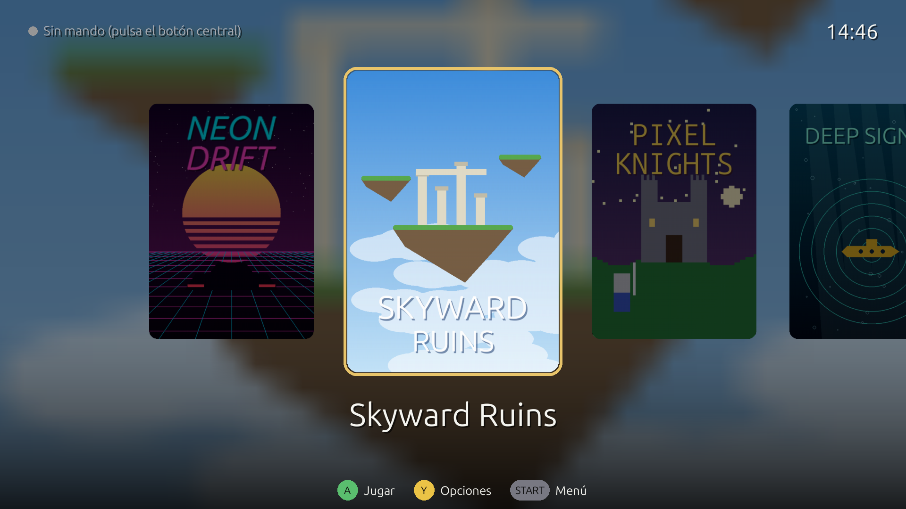
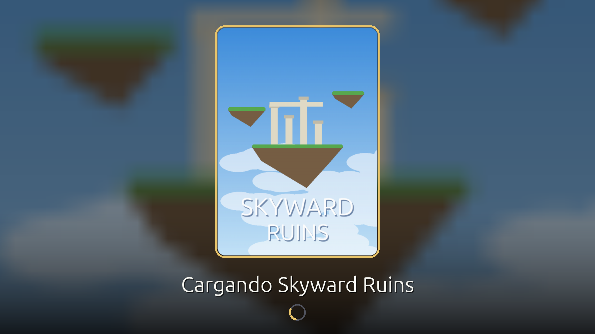
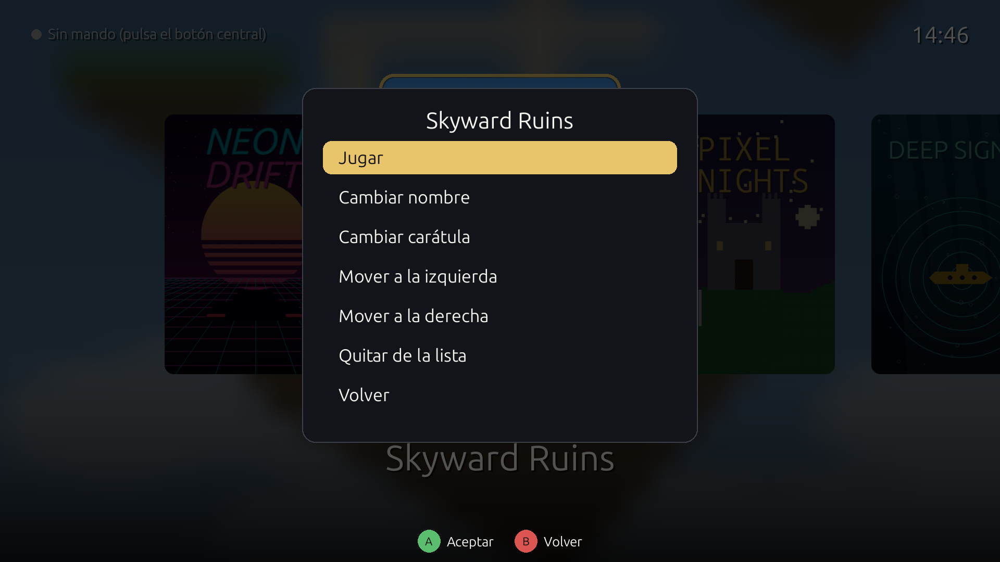
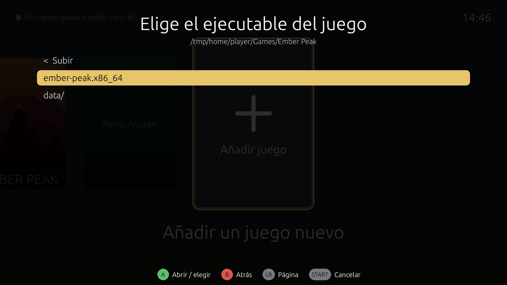
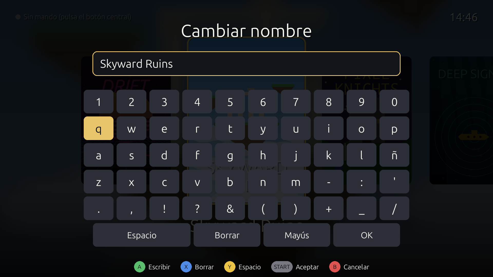
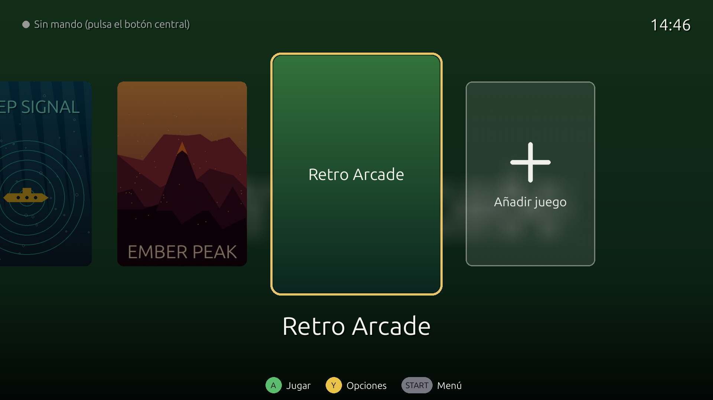

# Game Station Launcher

A fullscreen, gamepad-driven game launcher for a living-room Linux PC. It shows your games as large cover art, starts when you log in, and gives the game keyboard and controller focus when it opens, so you don't have to click on it first.

It was built for a couch PC that boots straight into a "console-like" menu: power on → GRUB → auto-login → launcher.

> **Note:** the on-screen text is currently in **Spanish** (for example *Jugar*, *Añadir juego*, *Opciones*). All strings are in `launcher.py` if you want to translate them.



| Loading screen while the game starts | Per-game options |
|---|---|
|  |  |
| **Adding a game: file browser** | **On-screen keyboard** |
|  |  |
| **Game without a cover (generated placeholder) and the "add game" tile** | |
|  | |

<sub>The games and covers in the screenshots are fictional placeholders made for this README.</sub>

## Features

- **Fullscreen carousel of cover art.** The selected game is enlarged, and its cover, blurred, becomes the background.
- **Gamepad first.** Works with any SDL-supported controller, including Bluetooth ones, with hot-plugging. Keyboard and mouse also work.
- **No focus problems.** When you pick a game, the launcher shows a loading screen and stays behind the game. A small GNOME Shell extension brings the game window to the front as soon as it appears.
- **Smooth transitions in both directions.** It fades into a loading screen with the cover art and fades back to the carousel when you quit the game. The desktop is never shown in between.
- **Add games from the couch.** A built-in file browser and on-screen keyboard, both usable with the gamepad, let you pick the executable, an optional cover image and a name.
- **Per-game options.** Rename, change the cover, reorder, or remove a game from the list.
- **System menu.** Exit to desktop, reboot, power off.
- **Light on resources.** It drops to 15 FPS when idle and stops drawing while a game is running.

## Tested environment

| Component | Version |
|---|---|
| OS | **Ubuntu 26.04.1 LTS** |
| Desktop | **GNOME Shell 50.1** on **Wayland** (the default Ubuntu session) |
| Kernel | 7.0.0-43-generic |
| Python | 3.14.4 (system `python3`) |
| pygame | 2.6.1 (Ubuntu package `python3-pygame`), SDL 2.32.10 |
| GPU | AMD Radeon R9 290 (`amdgpu` driver) |
| Controller | Generic Bluetooth gamepad |
| Display | 4K TV over HDMI (the UI renders at 1920×1080 and is scaled by the GPU) |

Other recent Ubuntu or Debian releases with GNOME on Wayland should work. The GNOME extension declares `"shell-version": ["50"]`; on another GNOME version, add that version to `gnome-extension/zlauncher-helper@game-station/metadata.json`. See [Without the GNOME extension](#without-the-gnome-extension) for desktops other than GNOME.

## Dependencies

All dependencies come from the Ubuntu archive. Nothing is installed with `pip`.

| Package | Used for |
|---|---|
| `python3` | Runs the launcher (installed by default) |
| `python3-pygame` | Window, rendering and gamepad input (SDL2) |
| `libglib2.0-bin` | `gdbus` and `gsettings`, to check and enable the GNOME extension (installed by default) |
| `util-linux` | `flock`, to make sure only one launcher runs (installed by default) |
| `fonts-ubuntu` | UI font (installed by default; otherwise pygame's built-in font is used) |

`systemctl` (systemd) is used for the *Reboot* and *Power off* menu entries.

## Installation

```sh
git clone https://github.com/danielcastropalomares/game-launcher.git
cd game-launcher
./install.sh --deps      # --deps installs the apt packages above (asks for sudo)
```

Then **log out and back in, or reboot**. GNOME only loads a newly installed extension at login. From then on, the launcher starts automatically each time you log in.

Installer options:

| Option | Effect |
|---|---|
| `--deps` | `sudo apt-get install` the dependencies |
| `--no-autostart` | Do not start the launcher at login. You can still open it from the app grid as **Game Station**. |

Run `./install.sh` again to update. Your game list is kept.

### Optional: make it boot like a console

The launcher handles the menu itself. To go from power-on to the menu without any interaction:

1. **Enable automatic login.** Go to *Settings → System → Users → Automatic Login*, or set these in `/etc/gdm3/custom.conf`:
   ```ini
   [daemon]
   AutomaticLoginEnable=True
   AutomaticLogin=<your-user>
   ```
2. **Shorten the GRUB menu** (optional). In `/etc/default/grub`, set `GRUB_TIMEOUT=3` (and `GRUB_RECORDFAIL_TIMEOUT=3`), then run `sudo update-grub`.

   On dual-boot systems, `GRUB_TIMEOUT=0` with a hidden menu is silently turned into 10 seconds by `os-prober`. Use a small non-zero value instead.
3. **Disable screen blanking**, so the TV does not go dark while you sit in the menu:
   ```sh
   gsettings set org.gnome.desktop.session idle-delay 0
   ```

## Adding games

### From the launcher (gamepad)

1. Go to the **+ Añadir juego** tile at the end of the carousel and press **A**. You can also choose *Añadir juego* from the **Start** menu.
2. **Pick the executable.** The browser lists folders and launchable files: ELF binaries, scripts with a shebang, `.AppImage`, `.sh` and `.x86_64`.
3. **Pick a cover image** (`.png`, `.jpg`, `.webp`, `.bmp`), or choose *Sin carátula* (no cover) to use a generated placeholder. Images are copied to `~/.config/zlauncher/covers/`.
4. **Type a name** with the on-screen keyboard. A name is suggested from the file name.

The browser starts in `browse_root` (see below). Point it at your games folder.

Portrait covers with a 2:3 ratio look best, such as Steam "capsule" or SteamGridDB grid images. Other sizes are center-cropped.

### By editing `games.json`

The game list is stored in `~/.config/zlauncher/games.json`:

```json
{
  "games": [
    {
      "name": "My Game",
      "exec": "/home/USER/Games/my-game/my-game.x86_64",
      "cwd": "/home/USER/Games/my-game",
      "cover": "/home/USER/.config/zlauncher/covers/my-game.png",
      "args": ["--fullscreen"],
      "env": {"SOME_VAR": "1"}
    }
  ],
  "last": 0,
  "browse_root": "~/Games",
  "joy_buttons": {"a": 0, "b": 1, "x": 2, "y": 3, "select": 6, "start": 7}
}
```

| Key | Meaning |
|---|---|
| `name` | Title shown under the cover |
| `exec` | Absolute path to the executable (must be executable) |
| `cwd` | Working directory. Defaults to the executable's folder. |
| `cover` | Optional cover image |
| `args` | Optional command-line arguments |
| `env` | Optional extra environment variables for that game |
| `last` | Index of the last game played (restored on start) |
| `browse_root` | Folder where the *add game* browser starts |
| `joy_buttons` | Button numbers for controllers that SDL does not recognise as a "game controller" (see [Troubleshooting](#troubleshooting)) |

[`examples/games.json`](examples/games.json) contains a full example.

## Controls

| Action | Gamepad | Keyboard | Mouse |
|---|---|---|---|
| Move | D-pad / left stick | Arrow keys | Wheel |
| Play / accept | **A** | Enter | Click the selected cover |
| Game options | **Y** | F2 | Right click |
| Back / cancel | **B** | Esc | |
| Menu (add game, exit to desktop, reboot, power off) | **Start** / Select / Guide | Tab | |
| First / last game, page up / down in the browser | **LB / RB** | Page Up / Page Down | |
| Delete / space (on-screen keyboard) | **X** / **Y** | Backspace / Space | |

A and B follow SDL's position-based layout, the Xbox convention: A is the bottom face button.

## How it works

```
login ─► session.sh ─► launcher.py --menu
                           │  A pressed
                           ▼
                fade to the loading screen
                spawn the game (child process)
                           │
     GNOME extension: a new window appeared while the launcher
     is open → activate it (bring it to the front, give it focus)
                           │
                game running: launcher idle behind it
                           │  game process exits
                           ▼
                fade back to the carousel
```

- **`session.sh`** is started at login. It holds a lock, so only one instance runs, and handles *Exit to desktop*, *Reboot* and *Power off*. If the launcher crashes, it exits to the desktop instead of restarting in a loop.
- **`launcher.py`** is the UI, written in pygame. Its window uses the Wayland app id `zlauncher`. Games are started with the environment the launcher itself received, so the SDL settings the launcher uses do not leak into them.
- **`zlauncher-helper@game-station`** is a GNOME Shell extension of about 60 lines. While a window with app id `zlauncher` exists, it activates any new normal window during its first two seconds. When the launcher is not running, it does nothing.

### Why not Steam Big Picture?

On GNOME/Wayland, a game launched from Big Picture often opens behind the Steam window, and you have to click it to get keyboard and controller focus. GNOME's focus-stealing prevention blocks the new window because the launcher still has focus. The helper extension solves exactly that.

### Without the GNOME extension

If the extension is not active (another desktop, another GNOME version, or not logged in again yet), the launcher detects it through `org.gnome.Shell.Extensions` and falls back to a simpler mode:

1. It closes its window before starting the game, so nothing can keep the focus.
2. `session.sh` runs the game.
3. The launcher reopens when the game exits.

Focus works the same way, but the desktop is visible for a moment during both transitions.

## Files

| Path | Contents |
|---|---|
| `~/.local/share/zlauncher/` | `launcher.py`, `session.sh` |
| `~/.config/zlauncher/games.json` | Game list and settings |
| `~/.config/zlauncher/covers/` | Copied cover images |
| `~/.local/share/gnome-shell/extensions/zlauncher-helper@game-station/` | GNOME helper extension |
| `~/.config/autostart/zlauncher.desktop` | Autostart entry |
| `~/.local/share/applications/zlauncher.desktop` | App grid entry ("Game Station") |
| `~/.local/state/zlauncher/launcher.log` | Launcher errors |
| `~/.local/state/zlauncher/game.log` | Output of every game started (`stdout` + `stderr`) |

If `~/.local/share/backgrounds/gamestation.png` exists, the launcher uses it as the background of the *add game* tile and as the starting image of its fade-in at boot. Set the same image as your desktop wallpaper for a seamless transition from boot to menu.

## Troubleshooting

**The game opens behind the launcher, or the desktop flashes when starting a game.**
The extension is not active. Check it:

```sh
gnome-extensions info zlauncher-helper@game-station   # State should be ACTIVE
```

If it says it does not exist, log out and back in. If it shows `OUT OF DATE`, add your GNOME version (`gnome-shell --version`) to its `metadata.json`.

**The controller buttons are mixed up or do nothing.**
Controllers that SDL recognises as "game controllers" are mapped automatically. Other controllers use raw button numbers from `joy_buttons` in `games.json`. To find your numbers:

```sh
python3 -c "
import pygame; pygame.init(); j = pygame.joystick.Joystick(0); print(j.get_name())
while True:
    for e in pygame.event.get():
        if e.type == pygame.JOYBUTTONDOWN: print('button', e.button)"
```

You can also add your controller to SDL's database with the `SDL_GAMECONTROLLERCONFIG` environment variable.

**"No encuentro el juego. ¿Está conectado el disco?"** ("game not found, is the drive connected?")
The `exec` path does not exist. This is common with games on an external or NTFS drive that is not mounted yet. Mount the drive from `/etc/fstab` (with `nofail`) so it is always available at login.

**"El juego se ha cerrado al arrancar"** ("the game closed while starting")
The game exited within a few seconds. Check `~/.local/state/zlauncher/game.log`.

**The launcher does not start at login.**
Check that `~/.config/autostart/zlauncher.desktop` exists and look at `~/.local/state/zlauncher/launcher.log`. You can also start it by hand to see errors:

```sh
~/.local/share/zlauncher/session.sh
```

**Exit to the desktop.** Press **Start** and choose *Salir al escritorio*. To open the launcher again, launch **Game Station** from the app grid.

## Uninstall

```sh
./uninstall.sh           # removes the program, extension and autostart entry; keeps your game list
./uninstall.sh --purge   # also deletes ~/.config/zlauncher and the logs
```

## Development

`launcher.py` can render offscreen for screenshots and quick checks, with no display needed:

```sh
SDL_VIDEODRIVER=dummy ZL_SHOT=/tmp/shot.png ZL_SCRIPT="right,y" \
  python3 launcher.py --menu /tmp/action
```

| Variable | Effect |
|---|---|
| `ZL_SHOT` | Save a PNG of the screen after the scripted actions, then exit |
| `ZL_SCRIPT` | Comma-separated actions to inject: `left,right,up,down,a,b,x,y,start,lb,rb` |
| `ZL_FAKE_HELPER=1` | Pretend the GNOME extension is active, to test the loading screen |

## License

Licensed under the [Apache License 2.0](LICENSE).
